# Yapay Zeka ve Dijital Dönüşüm Koordinatörlüğü
## Aday Mühendis Değerlendirme Projesi: IT Demirbaş ve Zimmet Yönetim Sistemi

Bu proje; kurum içindeki bilgisayar, sunucu, monitör gibi donanımların sisteme kaydedildiği, durumlarının takip edildiği, her bir cihaza benzersiz **QR Kod** üretildiği ve personellere zimmetlendiği **Full-Stack Web** ve **React Native Mobil** uygulamasıdır.

---

## 📸 Uygulama Arayüz Galerisi (70 Ekran Görüntüsü)

Sistemdeki tüm Web, Mobil (React Native), Yönetici ve Personel ekranları, arıza ve zimmet süreçleri ile responsive arayüzler aşağıda **5'erli gruplar** halinde detaylı açıklamalarıyla listelenmiştir:

### 🔹 1. Web Yönetici: Gösterge Paneli ve Temel Envanter İşlemleri
| # | Ekran / İşlem | Açıklama | Önizleme |
| :-: | :--- | :--- | :---: |
| **01** | **Yönetici Gösterge Paneli (Dashboard)** | Kurumsal KPI sayaçları (Toplam, depoda, zimmetli, arızalı donanım), kategori/departman dağılım grafikleri ve son denetim log akışı. | [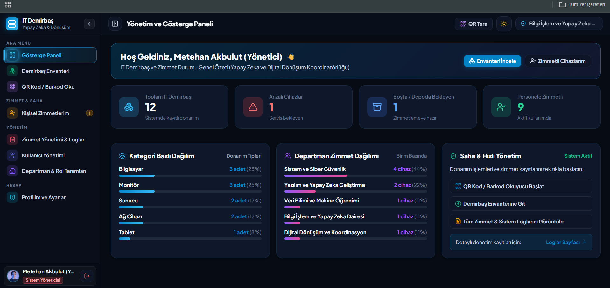](docs/screenshots/01-yoneticidashboard.png) |
| **02** | **Demirbaş Envanter Listesi** | Donanımların seri no, kategori, birim ve duruma göre filtrelenebilir dinamik arama tablosu. | [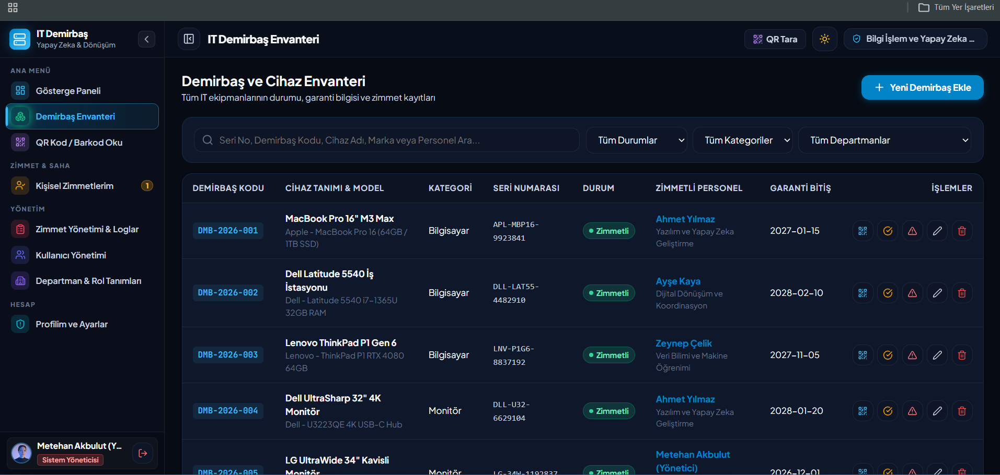](docs/screenshots/02-yoneticienvanter.png) |
| **03** | **Zimmet İade Kabul Ekranı** | Personel üzerindeki cihazın depoya veya bakıma geri iade alınması modal penceresi ve durum seçimi. | [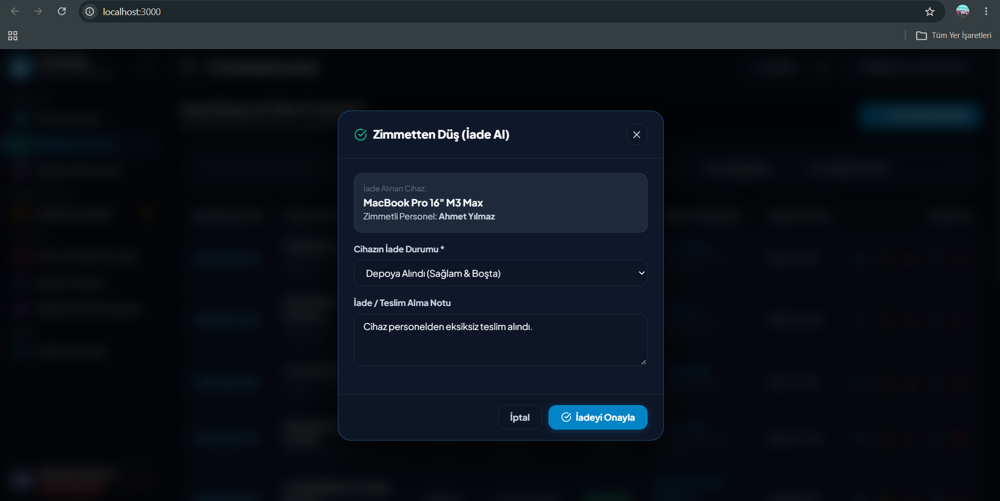](docs/screenshots/03-yoneticizimmetiade.png) |
| **04** | **Teknik Servis Arıza Bildirimi** | Cihazda oluşan arıza ve teknik problemlerin detaylarıyla sisteme arıza kaydı olarak girilmesi. | [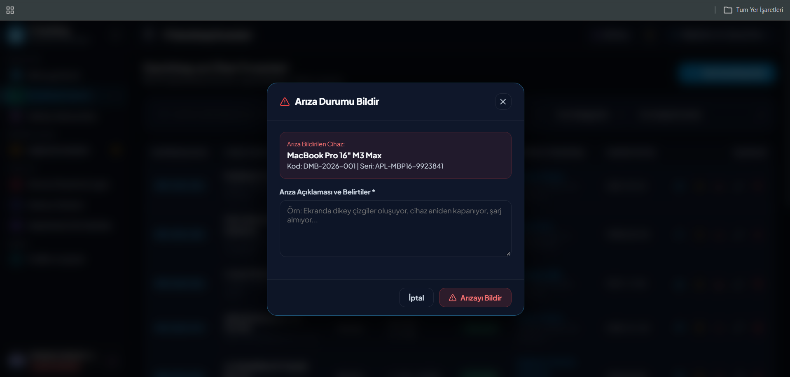](docs/screenshots/04-yoneticiarizabildir.png) |
| **05** | **Demirbaş Bilgisi Düzenleme** | Marka, model, seri numarası, kategori ve garanti bitiş tarihi gibi donanım bilgilerinin güncellenmesi. | [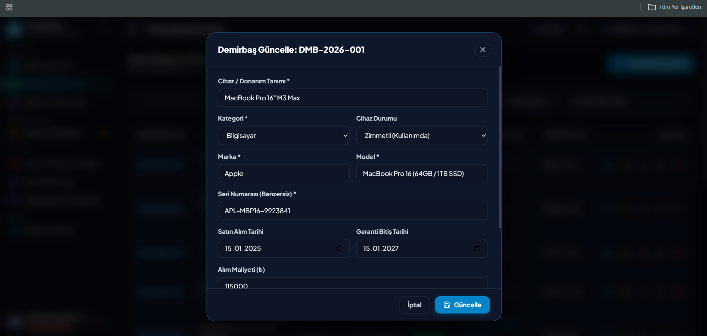](docs/screenshots/05-yoneticizimmetduzenle.png) |

### 🔹 2. Web Yönetici: Silme, Ekleme, Barkod/QR ve Kişisel Zimmet
| # | Ekran / İşlem | Açıklama | Önizleme |
| :-: | :--- | :--- | :---: |
| **06** | **Demirbaş Kaydı Silme Onayı** | Hatalı veya mükerrer girilen cihaz kayıtlarının güvenli onay penceresiyle sistemden silinmesi. | [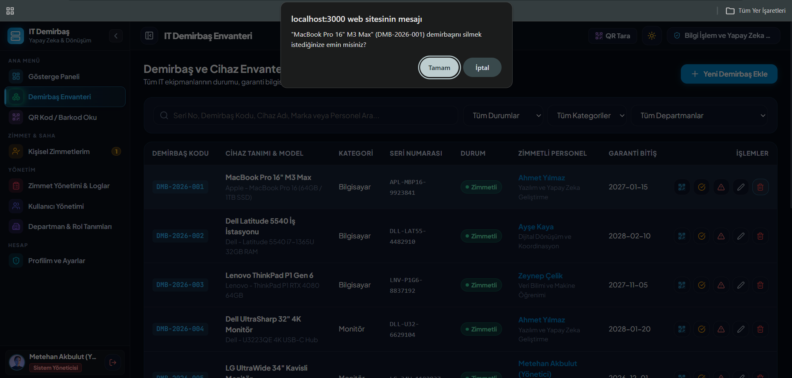](docs/screenshots/06-yoneticizimmetsil.png) |
| **07** | **Yeni Demirbaş Ekleme** | Kuruma yeni katılan donanımların seri numarası, garanti, alım tarihi ve maliyet bilgileriyle sisteme kaydedilmesi. | [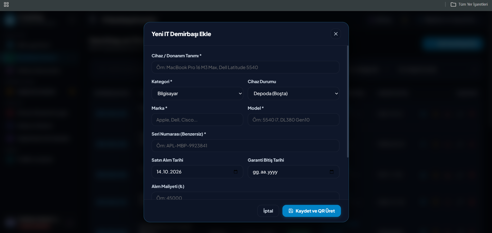](docs/screenshots/07-yoneticizimmetekle.png) |
| **08** | **Web QR Kod & Barkod Tarayıcı** | Kamerayla veya kod simülasyonuyla cihazın anında sorgulandığı canlı tarayıcı modalı. | [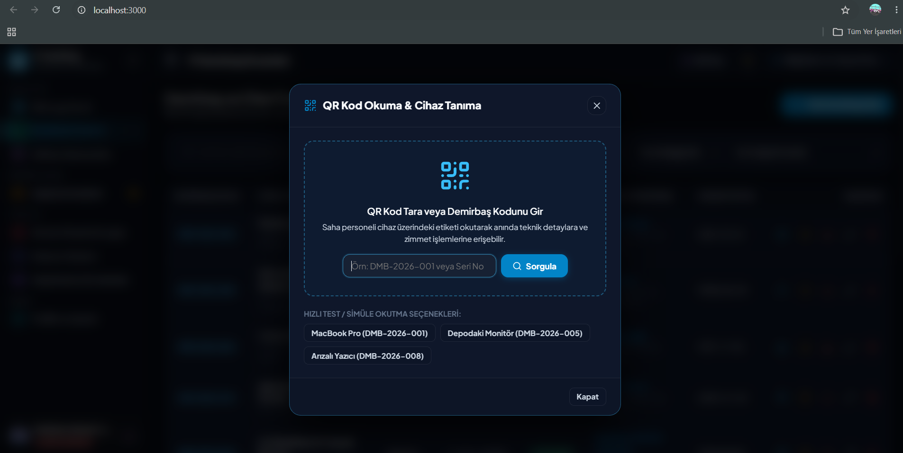](docs/screenshots/08-yoneticibarkodoku.png) |
| **09** | **Taranan Cihaz Tanıma Kartı** | Okutulan QR kodun donanım kime zimmetli, garantisi ne zaman bitiyor, durumu nedir anında getirdiği bilgi kartı. | [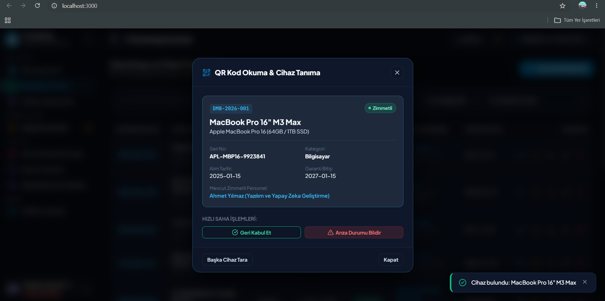](docs/screenshots/09-yoneticicihazbulundu.png) |
| **10** | **Yönetici Kişisel Zimmetlerim** | Yöneticinin kendi kullanımına tahsis edilen donanımları listeleyip takip ettiği alan. | [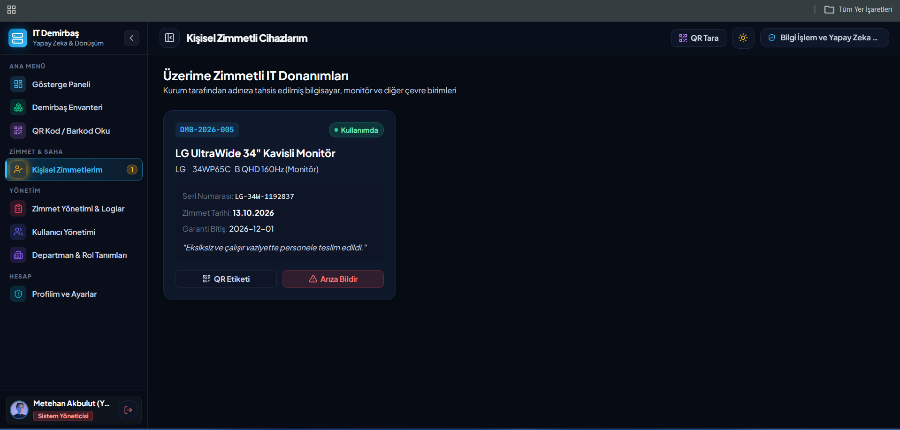](docs/screenshots/10-yoneticizimmeti.png) |

### 🔹 3. Web Yönetici: Zimmet Yönetimi, Denetim Logları ve Kullanıcılar
| # | Ekran / İşlem | Açıklama | Önizleme |
| :-: | :--- | :--- | :---: |
| **11** | **Kurumsal Zimmet Yönetimi Tablosu** | Kurum genelindeki tüm aktif zimmetler, teslim tarihleri ve personel dağılım listesi. | [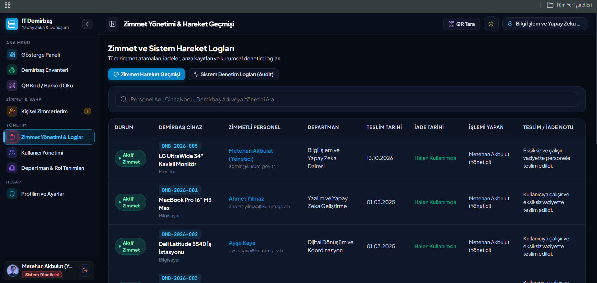](docs/screenshots/11-yoneticizimmetyonetimi.png) |
| **12** | **Sistem ve Denetim (Audit) Logları** | Hangi kullanıcının hangi cihazı teslim aldığı, iade ettiği veya arıza bildirdiğini gösteren zaman damgalı log akışı. | [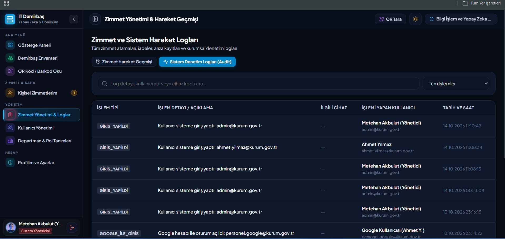](docs/screenshots/12-yoneticidenetimloglari.png) |
| **13** | **Kullanıcı & Personel Yönetimi** | Kurum personellerinin rolleri, departmanları, iletişim bilgileri ve zimmetli cihaz sayılarıyla listelendiği yönetim ekranı. | [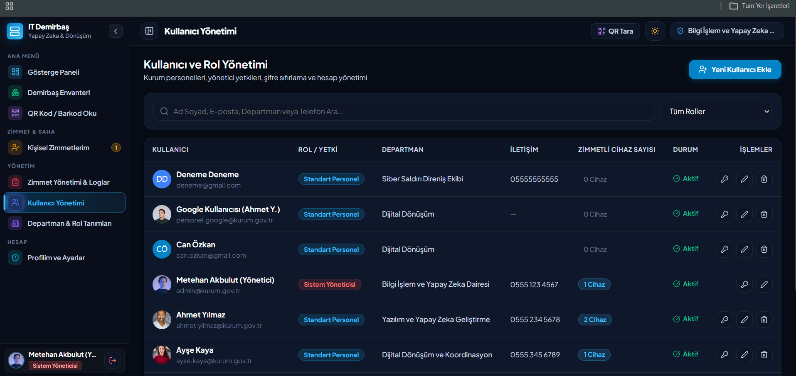](docs/screenshots/13-yoneticikullaniciyonetimi.png) |
| **14** | **Kullanıcı Şifre Sıfırlama** | Yöneticinin personele geçici şifre ataması veya güvenlik amaçlı şifre yenileme penceresi. | [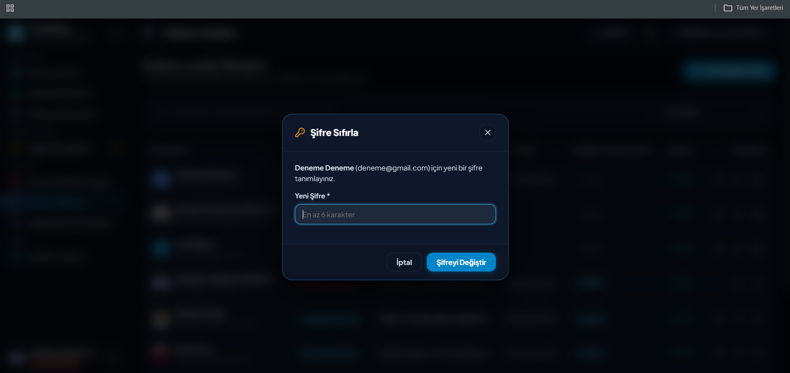](docs/screenshots/14-yoneticikullanicisifreislem.png) |
| **15** | **Kullanıcı Bilgileri Düzenleme** | Personelin ad-soyad, e-posta, telefon, departman ve yetki rolünün güncellenmesi. | [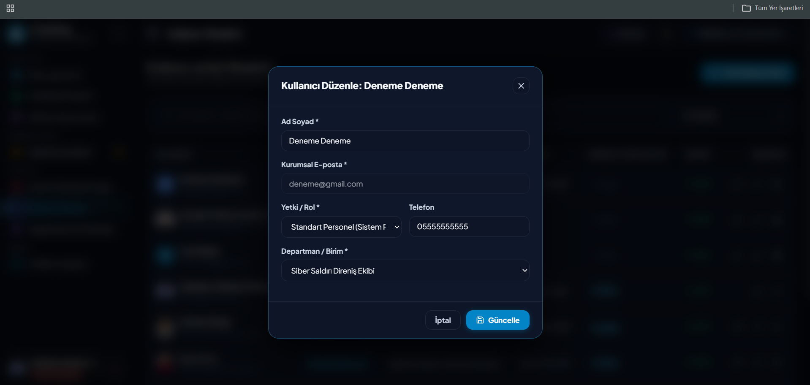](docs/screenshots/15-yoneticikullaniciduzenle.png) |

### 🔹 4. Web Yönetici: Kullanıcı Silme/Ekleme ve Departman Yönetimi
| # | Ekran / İşlem | Açıklama | Önizleme |
| :-: | :--- | :--- | :---: |
| **16** | **Personel Hesabı Silme Onayı** | Kurumdan ayrılan personelin sistemden güvenli şekilde silinmesini sağlayan onay diyaloğu. | [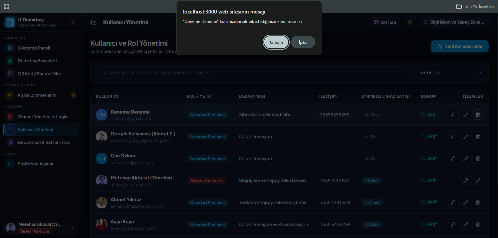](docs/screenshots/16-yoneticikullanicisil.png) |
| **17** | **Yeni Personel / Kullanıcı Ekleme** | Sisteme yeni dahil olan personele ad, e-posta, şifre, birim ve rol tanımlayarak hesap oluşturma. | [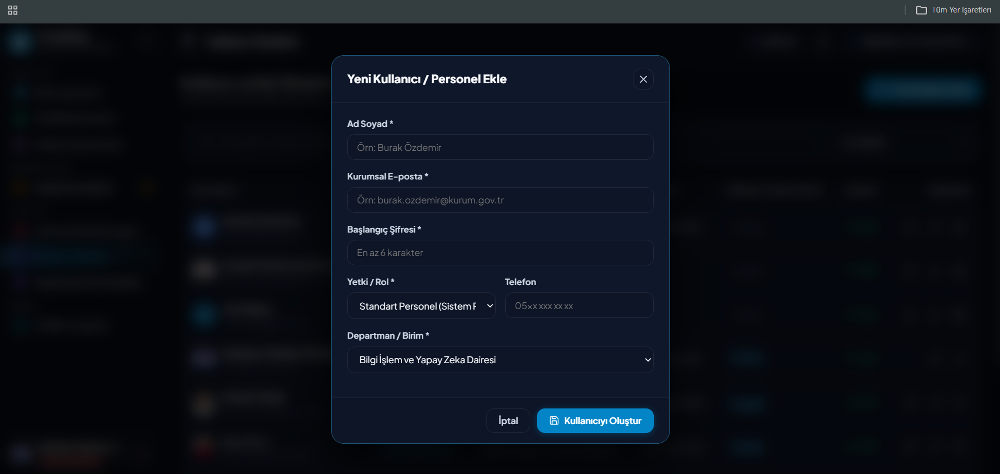](docs/screenshots/17-yoneticikullaniciekle.png) |
| **18** | **Departman Tanımları ve Listesi** | Kurum bünyesindeki birimlerin ve departmanların listelendiği yönetim tablosu. | [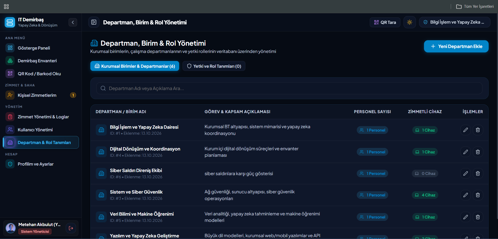](docs/screenshots/18-yoneticidepartmentislem.png) |
| **19** | **Departman Düzenleme** | Mevcut bir departmanın adının ve kurumsal açıklamasının güncellenmesi. | [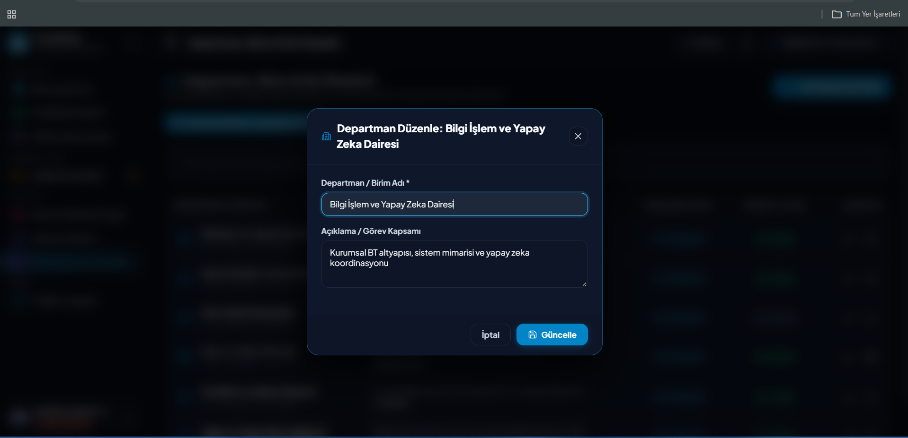](docs/screenshots/19-yoneticidepartmentduzenle.png) |
| **20** | **Departman Silme Onayı** | Boşta kalan departman tanımının sistemden kaldırılması onay penceresi. | [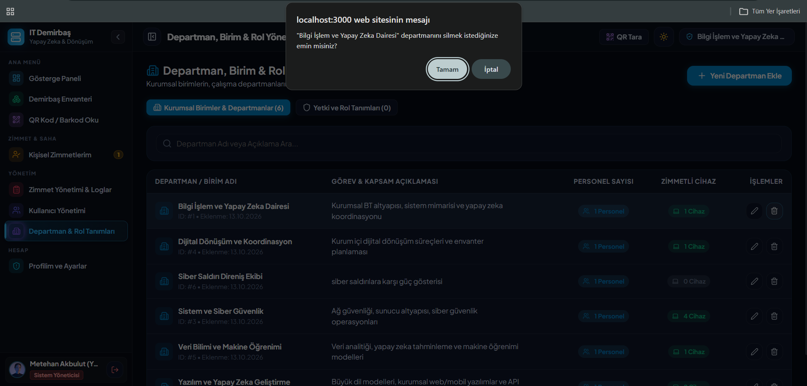](docs/screenshots/20-yoneticidepartmentsil.png) |

### 🔹 5. Web Yönetici: Departman Ekleme ve Rol Tanımları
| # | Ekran / İşlem | Açıklama | Önizleme |
| :-: | :--- | :--- | :---: |
| **21** | **Yeni Departman Tanımlama** | Kuruma yeni bir birim (Örn: Bilgi İşlem Dairesi) ekleme formu. | [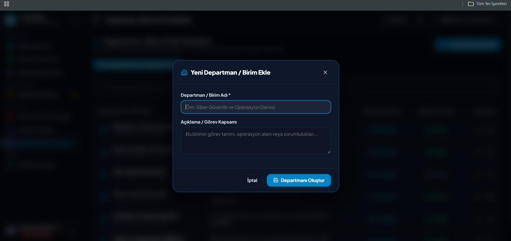](docs/screenshots/21-yoneticidepartmentekle.png) |
| **22** | **Kullanıcı Rolleri ve İzinler Tablosu** | Sistemde tanımlı rollerin (Admin, Personel vb.) görüntülendiği ekran. | [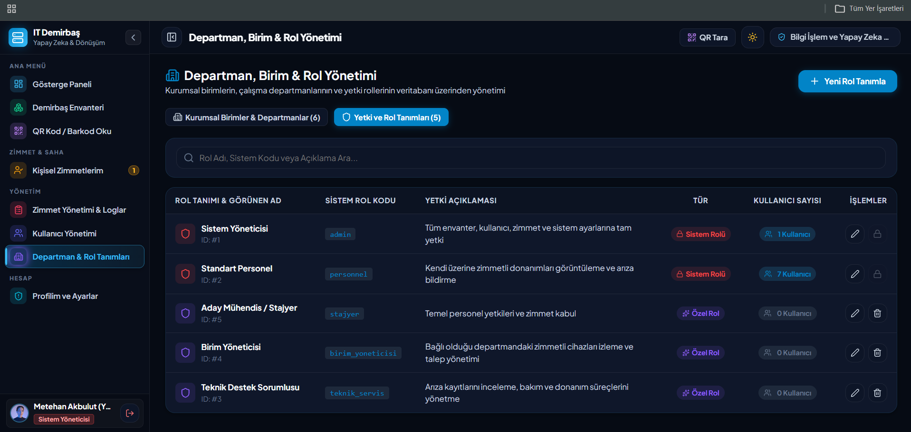](docs/screenshots/22-yoneticirolislem.png) |
| **23** | **Kullanıcı Rolü Düzenleme** | Rol adının ve yetki kapsamının düzenlendiği modal pencere. | [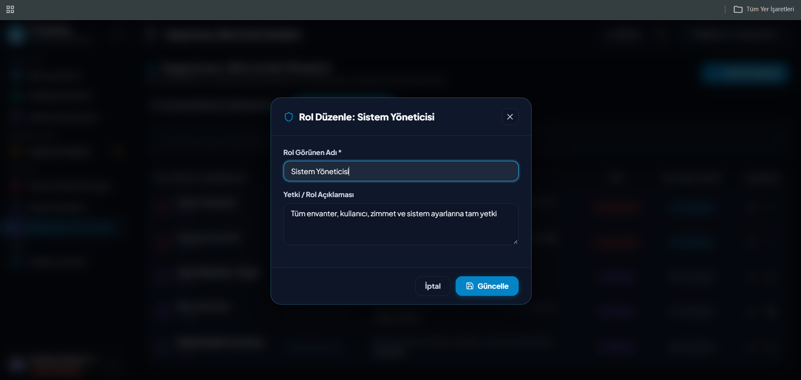](docs/screenshots/23-yoneticirolduzenle.png) |
| **24** | **Rol Silme Onayı** | Kullanılmayan sistem rollerinin silinmesini sağlayan uyarı ekranı. | [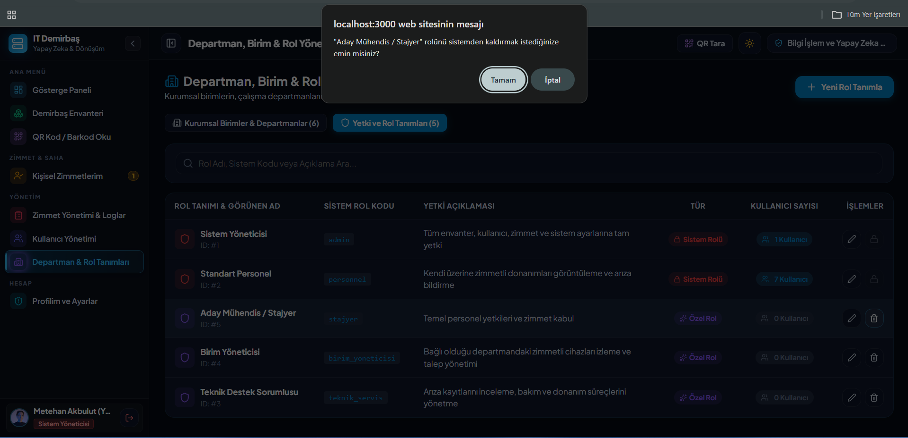](docs/screenshots/24-yoneticirolsil.png) |
| **25** | **Yeni Rol Ekleme** | Kuruma özgü yeni yetki seviyeleri tanımlama arayüzü. | [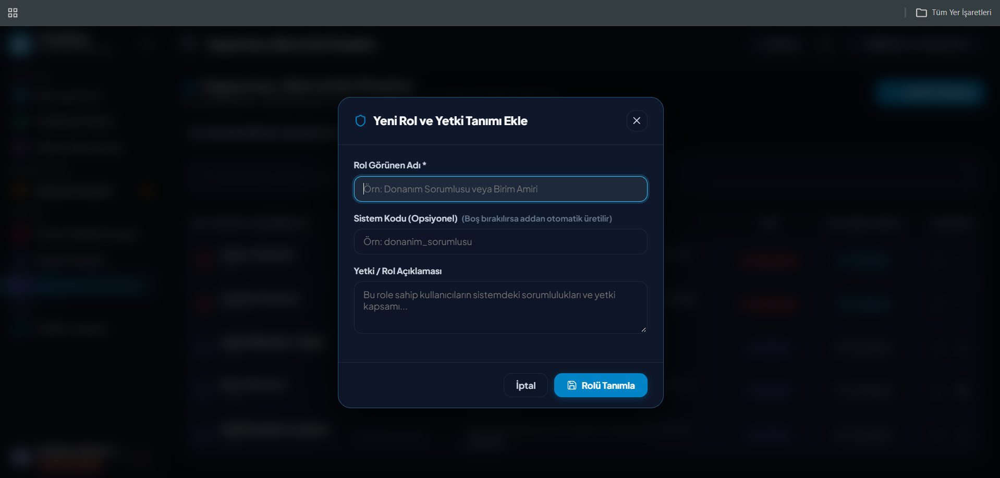](docs/screenshots/25-yoneticirolekle.png) |

### 🔹 6. Web Yönetici Profil ve Web Personel Deneyimi
| # | Ekran / İşlem | Açıklama | Önizleme |
| :-: | :--- | :--- | :---: |
| **26** | **Yönetici Profil ve Güvenlik Ayarları** | Profil bilgileri, e-posta ve güvenli şifre değiştirme paneli. | [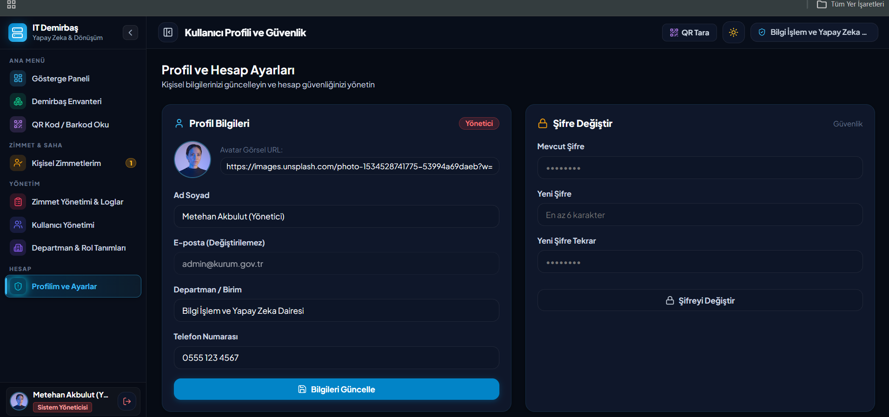](docs/screenshots/26-yoneticiprofilislem.png) |
| **27** | **Açık (Light) Tema ve Katlanabilir Menü** | Tek tıkla açık temaya geçiş ve daraltılabilir/ikon modlu yeni kenar çubuğu (Sidebar). | [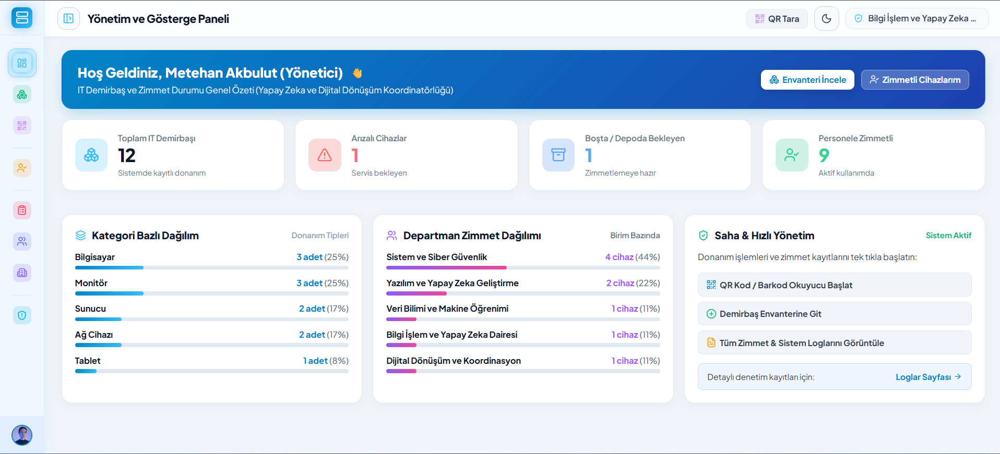](docs/screenshots/27-aciktemaveacilirkapanirsecmenu.png) |
| **28** | **Personel Gösterge Paneli** | Normal personelin karşılaştığı, yönetim karmaşasından uzak sade ve odaklı KPI göstergeleri. | [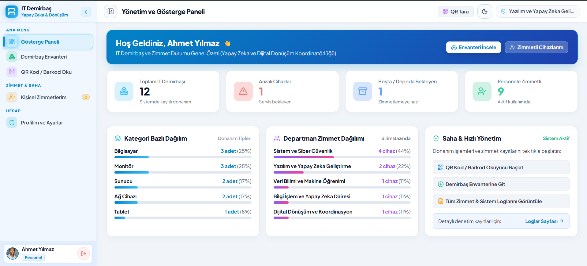](docs/screenshots/28-personeldashboard.png) |
| **29** | **Personel Demirbaş Listesi (Salt-Okunur)** | Personelin envanteri görüntüleyebildiği ancak silme/düzenleme butonlarının gizlendiği güvenli liste. | [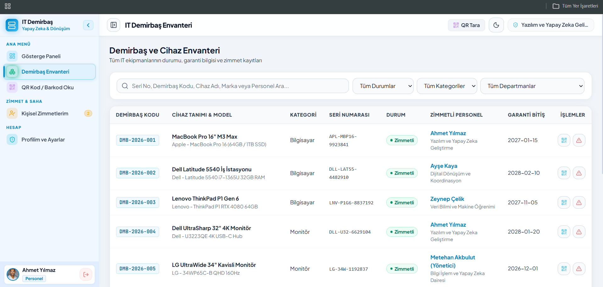](docs/screenshots/29-personelenvanter.png) |
| **30** | **Personel Arıza Bildirimi** | Personelin envanterdeki herhangi bir cihaz için arıza kaydı oluşturabildiği form. | [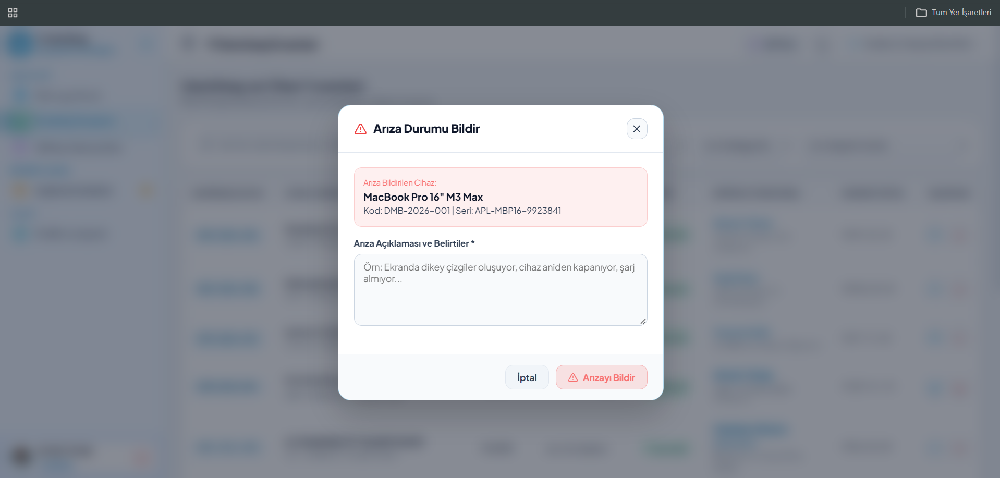](docs/screenshots/30-personelarizasildir.png) |

### 🔹 7. Web Personel Süreçleri ve Responsive Tasarım
| # | Ekran / İşlem | Açıklama | Önizleme |
| :-: | :--- | :--- | :---: |
| **31** | **Personel QR Tarama Arayüzü** | Personelin ofisteki cihazları kamerayla okutabileceği tarama penceresi. | [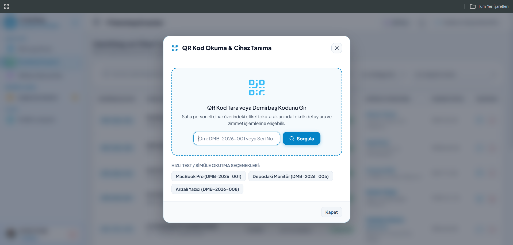](docs/screenshots/31-personeltarama.png) |
| **32** | **Taranan Cihaz ve Personel Yetki Sınırı** | Cihaz kime ait olduğunu gösterirken personelden teslim etme butonlarının gizlendiği güvenli ekran. | [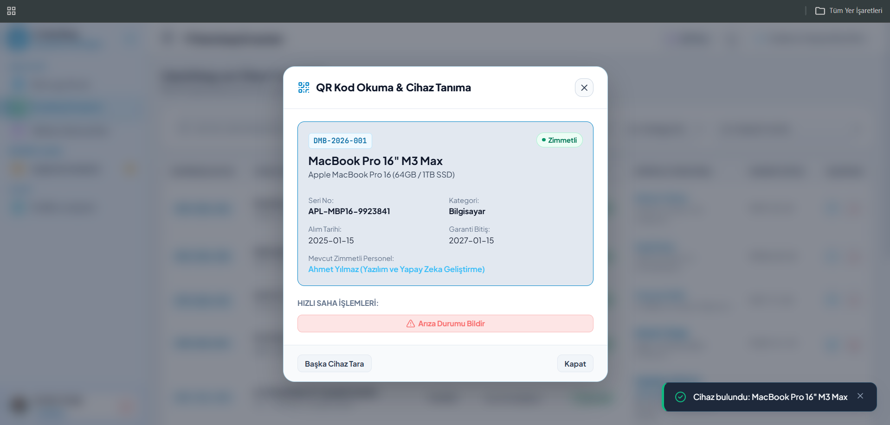](docs/screenshots/32-personelurunbulmauyari.png) |
| **33** | **Personelin Kendi Zimmetleri** | Personelin doğrudan kendi zimmetindeki cihazları görüp takip ettiği liste. | [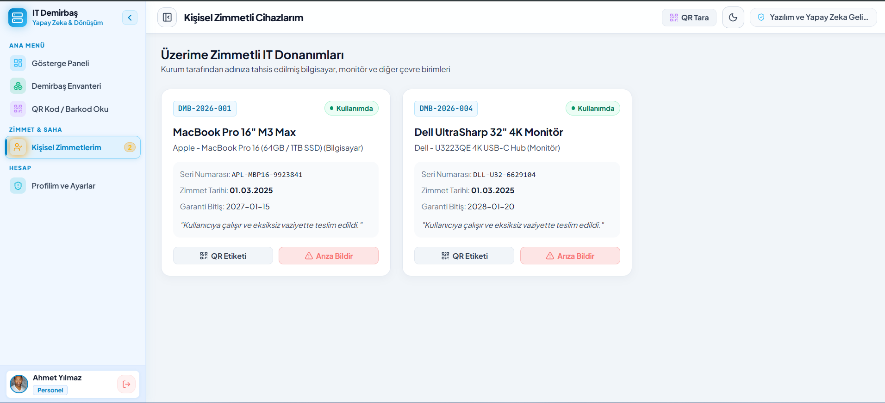](docs/screenshots/33-personelzimmeti.png) |
| **34** | **Personel Profil Ekranı** | Personelin iletişim bilgilerini düzenlediği ve şifresini değiştirdiği alan. | [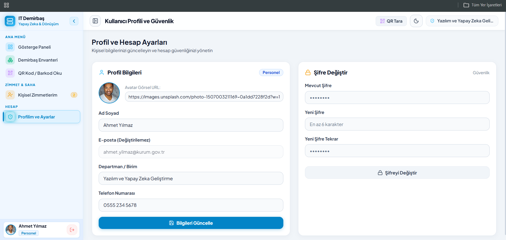](docs/screenshots/34-personelprofil.png) |
| **35** | **Responsive Gösterge Paneli (Mobil Web)** | Tablet ve mobil tarayıcılarda kusursuz oturan KPI kartları ve grafikler. | [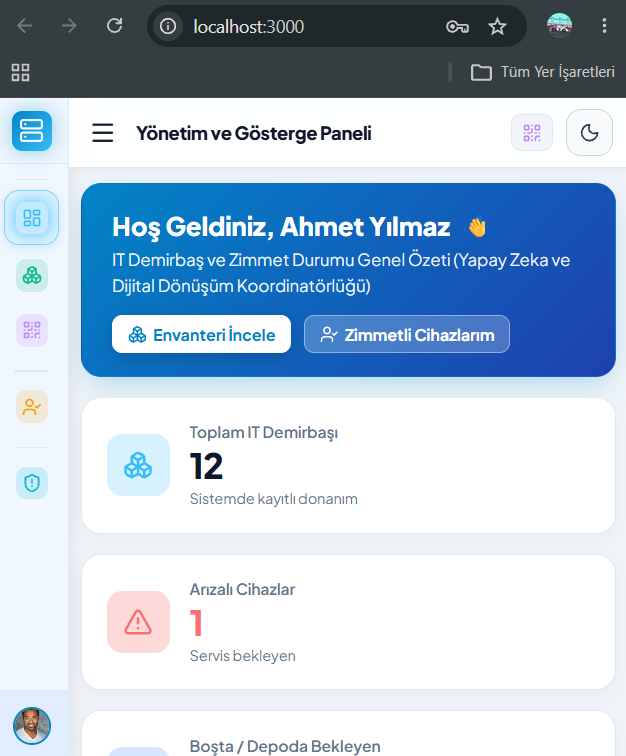](docs/screenshots/35-responsivedashboard.png) |

### 🔹 8. Web Responsive Görünümleri ve Mobil Personel
| # | Ekran / İşlem | Açıklama | Önizleme |
| :-: | :--- | :--- | :---: |
| **36** | **Responsive Envanter Görünümü** | Dar ekranlarda yatay taşma yapmayan, kart formuna dönüşen akıllı demirbaş listesi. | [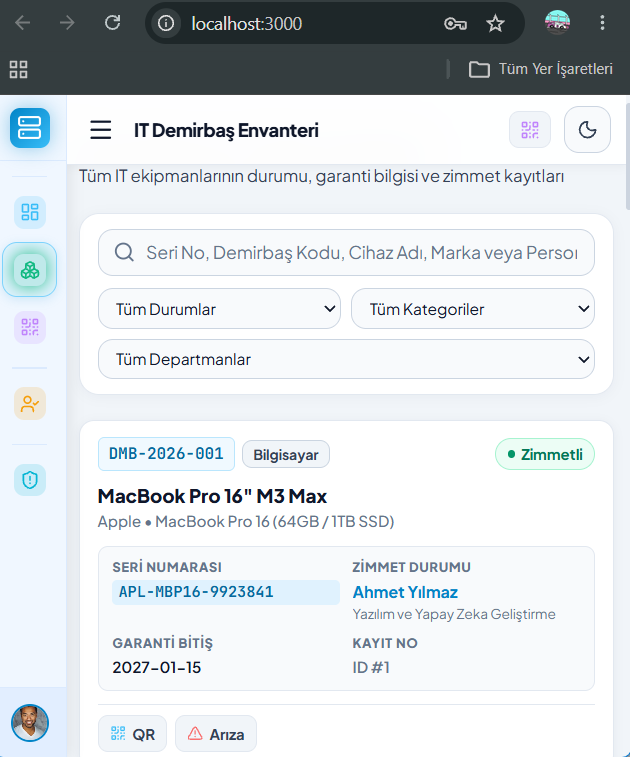](docs/screenshots/36-responsiveenvanter.png) |
| **37** | **Responsive QR Tarama** | Mobilde tam ekran açılan ve dokunmatik optimize QR tarayıcı. | [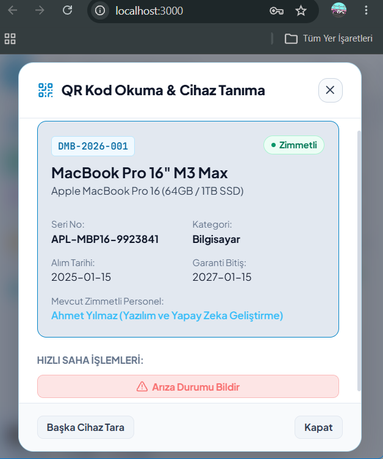](docs/screenshots/37-responsivetarama.png) |
| **38** | **Responsive Kişisel Zimmetlerim** | Mobil tarayıcıda personelin kendi cihazlarını gösteren responsive kartlar. | [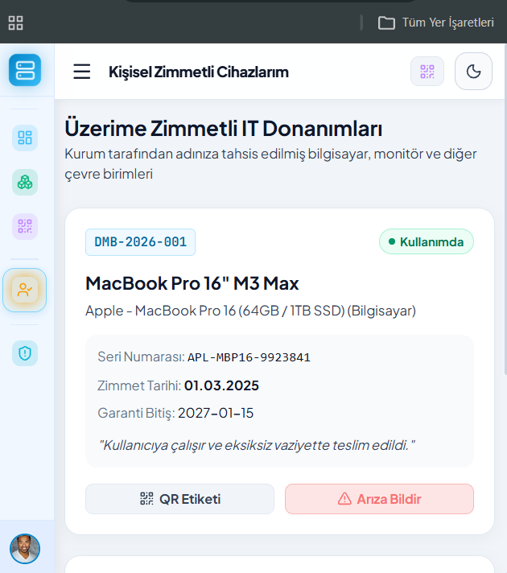](docs/screenshots/38-responsivezimmet.png) |
| **39** | **Mobil Uygulama: Personel Gösterge Paneli** | React Native mobil saha uygulamasının personel karşılama ekranı ve sayaçları. | [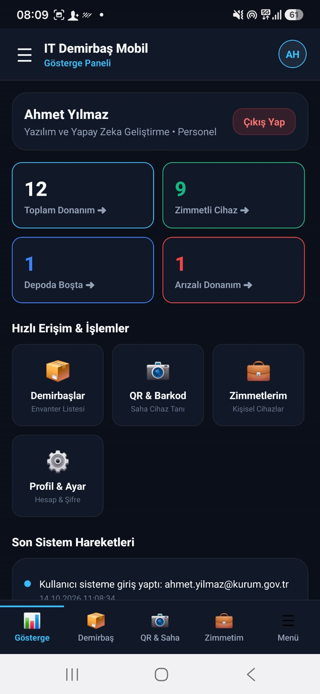](docs/screenshots/39-personelmobildashboard.jpeg) |
| **40** | **Mobil Uygulama: Aktivite ve Log Ekranı** | Mobil uygulama üzerinden gerçekleşen saha hareketlerinin anlık log akışı. | [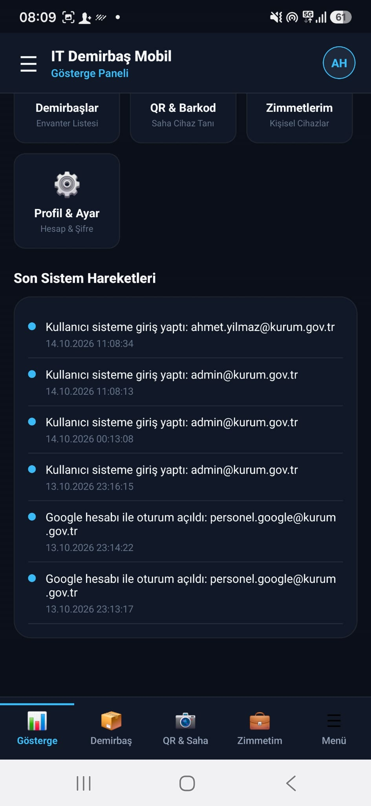](docs/screenshots/40-mobillogkaydi.jpeg) |

### 🔹 9. Mobil Personel: Envanter ve Cihaz Tanıma
| # | Ekran / İşlem | Açıklama | Önizleme |
| :-: | :--- | :--- | :---: |
| **41** | **Mobil Personel: Demirbaş Envanteri** | Mobil arayüzde kategori filtreli ve seri numaralı cihaz listesi. | [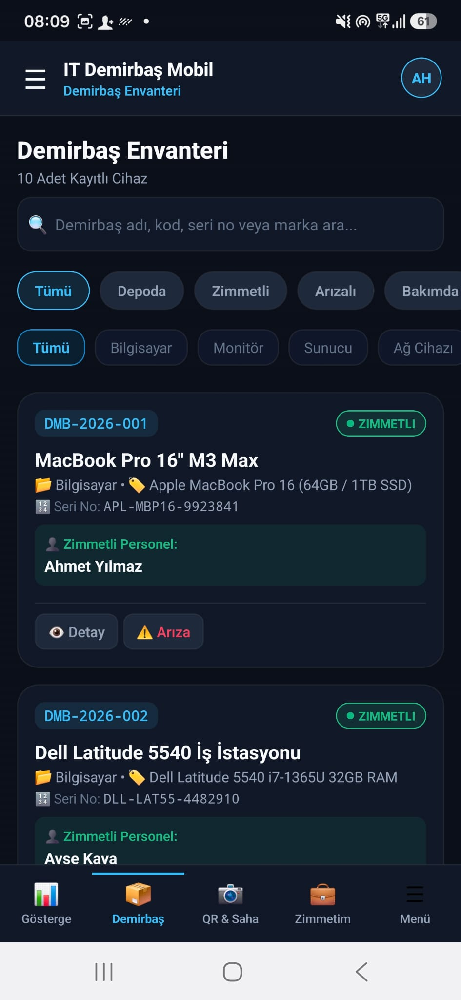](docs/screenshots/41-personelmobilenvanter.jpeg) |
| **42** | **Mobil Personel: Cihaz Detay Kartı** | Cihazın teknik özellikleri, QR kodu ve garanti süresinin görüntülendiği detay modalı. | [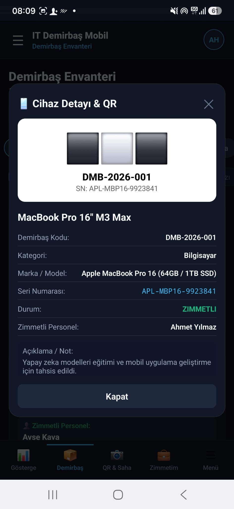](docs/screenshots/42-personelmobilurundetay.jpeg) |
| **43** | **Mobil Personel: Cihaz Arıza Bildirimi** | Cihaz kartı üzerinden doğrudan teknik servise arıza iletme formu. | [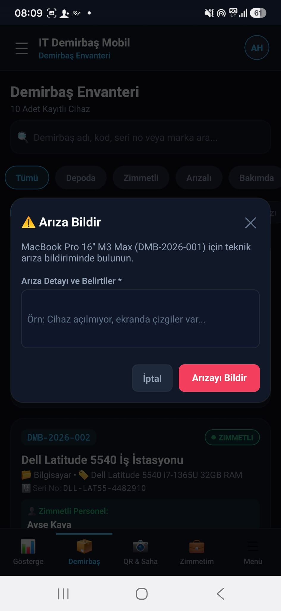](docs/screenshots/43-personelmobilurunariza.jpeg) |
| **44** | **Mobil Personel: Kamera ile QR Okuma** | Cihaz üstündeki fiziksel etiketi kamerayla anında tarama vizörü. | [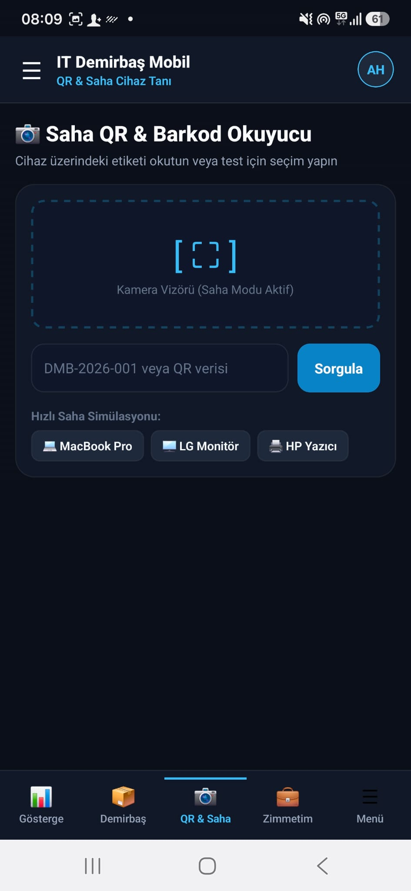](docs/screenshots/44-personelmobilurunokuma.jpeg) |
| **45** | **Mobil Personel: Tanınan Cihaz Bilgisi** | QR okuma sonrası cihazın model ve garanti durumunun anında ekrana gelmesi. | [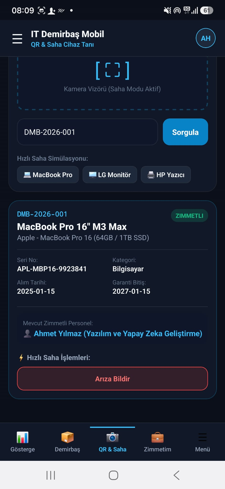](docs/screenshots/45-personelmobilurunbulundu.jpeg) |

### 🔹 10. Mobil Personel: Saha Arıza ve Hesap Yönetimi
| # | Ekran / İşlem | Açıklama | Önizleme |
| :-: | :--- | :--- | :---: |
| **46** | **Mobil Personel: Taranan Cihaza Arıza Kaydı** | Sahada taranan cihaz için tek tıkla arıza kaydı oluşturma. | [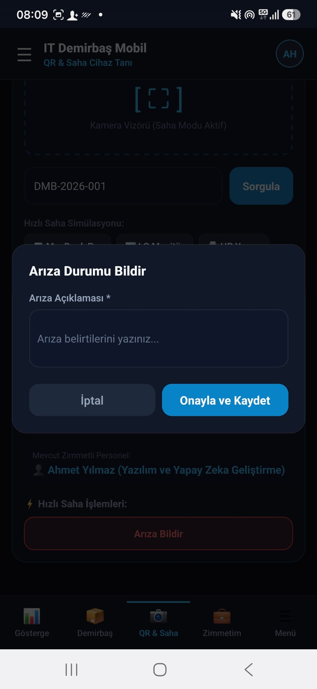](docs/screenshots/46-personelmobilbulunanurunariza.jpeg) |
| **47** | **Mobil Personel: Kişisel Zimmet Ekranı** | Personelin kendi adına zimmetlenmiş tüm kurumsal cihazların mobil listesi. | [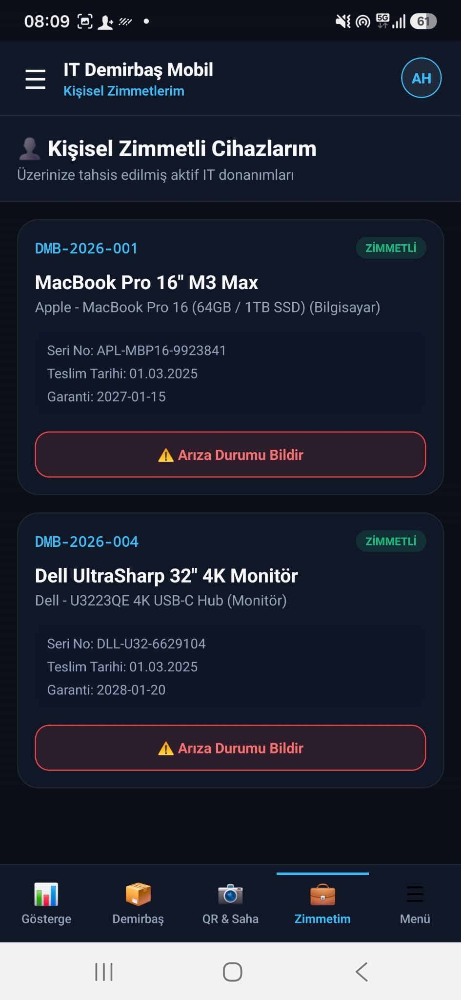](docs/screenshots/47-personelmobilzimmeti.jpeg) |
| **48** | **Mobil Personel: Çekmece (Drawer) Menü** | Sadece personelin yetkili olduğu sekmeleri içeren sadeleştirilmiş mobil menü. | [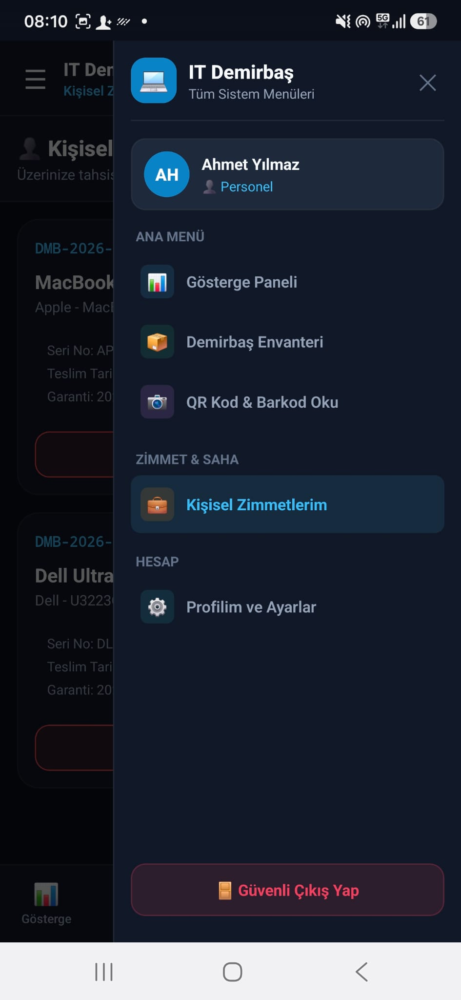](docs/screenshots/48-personelmobilmenu.jpeg) |
| **49** | **Mobil Personel: Profil Bilgileri** | Mobil üzerinden personelin kendi unvan, birim ve e-posta bilgilerini görüntülemesi. | [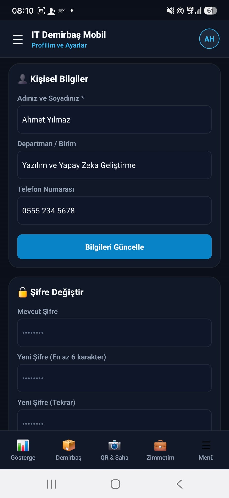](docs/screenshots/49-personelmobilprofil.jpeg) |
| **50** | **Mobil Personel: Güvenli Şifre Güncelleme** | Mobil kullanıcı için şifre doğrulama ve güncelleme ekranı. | [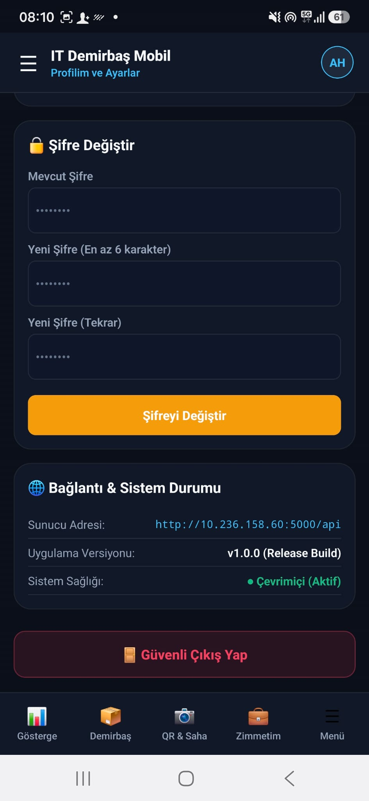](docs/screenshots/50-personelmobilsifre.jpeg) |

### 🔹 11. Mobil Yönetici: Dashboard ve Hızlı Saha İşlemleri
| # | Ekran / İşlem | Açıklama | Önizleme |
| :-: | :--- | :--- | :---: |
| **51** | **Mobil Yönetici: Gösterge Paneli** | Yöneticiler için kurumsal KPI sayaçları ve yönetim kısayolları. | [](docs/screenshots/51-yoneticimobildashboard.jpeg) |
| **52** | **Mobil Yönetici: Hızlı Saha Zimmetleme** | Sahadaki cihazı listeden seçilen bir personele anında zimmetleme formu. | [](docs/screenshots/52-yoneticimobilzimmetekle.jpeg) |
| **53** | **Mobil Yönetici: Saha QR Tarayıcı** | Yöneticiler için gelişmiş saha tarama ve cihaz tanıma kamerası. | [](docs/screenshots/53-yoneticimobiluruntarama.jpeg) |
| **54** | **Mobil Yönetici: Cihazı Geri Kabul Etme (İade)** | Sahada personelden alınan cihazın zimmetten düşülmesi ve depoya iade alınması. | [](docs/screenshots/54-yoneticimobilurunkabul.jpeg) |
| **55** | **Mobil Yönetici: Kendi Zimmetli Cihazları** | Yöneticinin şahsına zimmetli ekipmanların mobil takibi. | [](docs/screenshots/55-yoneticimobilzimmeti.jpeg) |

### 🔹 12. Mobil Yönetici: İade Kabul, Sistem Logları ve Personel Listesi
| # | Ekran / İşlem | Açıklama | Önizleme |
| :-: | :--- | :--- | :---: |
| **56** | **Mobil Yönetici: İade Onay Ekranı** | Cihaz teslim alma notu ve durum seçimiyle iade tamamlama diyaloğu. | [](docs/screenshots/56-yoneticimobilzimmetiade.jpeg) |
| **57** | **Mobil Yönetici: Mobil Sistem Logları** | Kurumdaki tüm zimmet, iade ve arıza hareketlerinin mobil log akışı. | [](docs/screenshots/57-yoneticimobilsistemloglari.jpeg) |
| **58** | **Mobil Yönetici: Yeni Zimmet Sözleşmesi** | Boştaki bir cihazın seçilerek yeni personele teslim kaydının oluşturulması. | [](docs/screenshots/58-yoneticimobilyenizimmet.jpeg) |
| **59** | **Mobil Yönetici: Personel Detay İnceleme** | Personelin unvanı, zimmetindeki cihaz sayısı ve iletişim detayları. | [](docs/screenshots/59-yoneticimobilpersonelgoruntule.jpeg) |
| **60** | **Mobil Yönetici: Yönetici Hesabı Görüntüleme** | Sistem yöneticisi hesap detaylarının ve yetkilerinin incelenmesi. | [](docs/screenshots/60-yoneticimobilyoneticigoruntule.jpeg) |

### 🔹 13. Mobil Yönetici: Personel ve Departman Yönetimi
| # | Ekran / İşlem | Açıklama | Önizleme |
| :-: | :--- | :--- | :---: |
| **61** | **Mobil Yönetici: Personel Şifre Sıfırlama** | Sahadaki personelin unuttuğu şifreyi yönetici tarafından sıfırlama ekranı. | [](docs/screenshots/61-yoneticimobilpersonelsifresifirla.jpeg) |
| **62** | **Mobil Yönetici: Personel Bilgilerini Düzenleme** | Personelin departman ve iletişim bilgilerini mobilden güncelleme. | [](docs/screenshots/62-yoneticimobilpersonelduzenle.jpeg) |
| **63** | **Mobil Yönetici: Personel Silme Onayı** | Kurumdan ayrılan personelin hesabının silinmesi için mobil güvenlik onayı. | [](docs/screenshots/63-yoneticimobilpersonelsil.jpeg) |
| **64** | **Mobil Yönetici: Yeni Personel Kaydı Açma** | Sahadan yeni bir personel kaydı ve kullanıcı hesabı tanımlama. | [](docs/screenshots/64-yoneticimobilpersonelekle.jpeg) |
| **65** | **Mobil Yönetici: Departmanlar Listesi** | Kurumun tüm daire ve birimlerinin mobil listesi. | [](docs/screenshots/65-yoneticimobildepartmanlar.jpeg) |

### 🔹 14. Mobil Yönetici: Departman, Rol ve Zimmet Düzenleme
| # | Ekran / İşlem | Açıklama | Önizleme |
| :-: | :--- | :--- | :---: |
| **66** | **Mobil Yönetici: Yeni Departman Ekleme** | Mobil üzerinden yeni bir departman oluşturma formu. | [](docs/screenshots/66-yoneticimobildepartmanekle.jpeg) |
| **67** | **Mobil Yönetici: Sistem Rolleri Listesi** | Mobil cihazdan erişilebilen kullanıcı rol ve izin tanımları tablosu. | [](docs/screenshots/67-yoneticimobilroller.jpeg) |
| **68** | **Mobil Yönetici: Departman Silme Onayı** | İhtiyaç kalmayan departmanın sistemden güvenle silinmesi. | [](docs/screenshots/68-yoneticimobildepartmansil.jpeg) |
| **69** | **Mobil Yönetici: Zimmet Geçmişi ve Detayı** | Bir donanımın kimler tarafından hangi tarihlerde kullanıldığının detaylı geçmişi. | [](docs/screenshots/69-yoneticimobilzimmetdetay.jpeg) |
| **70** | **Mobil Yönetici: Zimmet Kaydını Güncelleme** | Mevcut zimmet notlarının ve teslim detaylarının düzenlenmesi. | [](docs/screenshots/70-yoneticimobilzimmetduzenle.jpeg) |

---

## 🌟 Proje Özeti ve Temel Özellikler

| Alan | Karşılanan İsterler |
| :--- | :--- |
| **Kimlik Doğrulama (Auth)** | • **Google ile Giriş Yap** entegrasyonu ve demo simülasyonu<br>• Kullanıcı adı / e-posta ve şifre oluşturarak kayıt olma (Register)<br>• JWT tabanlı güvenli oturum yönetimi<br>• Profil bilgileri düzenleme ve şifre güncelleme<br>• Hızlı test için tek tıkla Yönetici (Admin) ve Personel giriş butonları |
| **Yetkilendirme (Rol Yönetimi)** | • **Admin** ve **Standart Personel** rol bazlı yetkilendirme altyapısı<br>• Yöneticiler için Kullanıcı Yönetim Ekranı (Yeni kullanıcı ekleme, silme, düzenleme, şifre sıfırlama) |
| **Dashboard (Gösterge Paneli)** | • Toplam donanım, arızalı cihazlar, depoda bekleyenler ve zimmetteki cihazlar (KPI Sayaçları)<br>• Kategori ve departman bazlı dinamik dağılım çubukları/grafikleri<br>• Son sistem ve zimmet aktiviteleri (Audit Log akışı) |
| **Envanter Yönetimi** | • Cihaz ekleme, silme, güncelleme (Marka, Model, Seri No, Alım Tarihi, Garanti, Maliyet)<br>• **Otomatik benzersiz taranabilir QR Kod üretimi**<br>• QR Kod önizleme, PNG olarak indirme ve fiziksel etiket yazdırma |
| **Zimmet Yönetimi** | • Personele teslim etme (Zimmetleme) ve zimmetten düşme (İade kabul)<br>• One-to-Many / Many-to-Many ilişkisel veritabanı kurgusu<br>• Detaylı geçmiş zimmet logları ve tarihçe takibi |
| **Arama & Filtreleme & UI/UX** | • Duruma (Depoda, Zimmetli, Arızalı, Bakımda, Hurda), kategoriye ve departmana göre filtreleme<br>• Canlı dinamik arama çubuğu ve çoklu sayfalama (Pagination: 10, 25, 50)<br>• Anlık bildirim mesajları (Toast / Snackbar: Başarılı, Hatalı, Uyarı)<br>• Ultra modern executive dark/light glassmorphic responsive tasarım |
| **Mobil Uygulama (React Native)** | • Kullanıcı adı/şifre ile mobil güvenli giriş<br>• **Kamera / QR Kod okuma ve cihaz tanıma** (Garanti, alım tarihi, kimde olduğu anında ekranda)<br>• **Hızlı Saha İşlemleri**: "Personele Teslim Et", "Cihazı Geri Kabul Et", "Arıza Durumu Bildir"<br>• **Kişisel Zimmet Ekranı**: Personelin kendi üzerine zimmetli donanımlarını listelemesi ve arıza bildirmesi |
| **DevOps & Dağıtım** | • **Docker ve docker-compose** ile tek tuşla ayağa kalkacak hazır mimari<br>• Nginx ters vekil ve API proxy yapılandırması |

---

## 🏗️ Mimari Yapı

```
koordinatörlük/
├── backend/                  # Node.js + Express + SQLite + JWT + QRCode REST API
│   ├── src/
│   │   ├── config/           # Veritabanı bağlantısı ve tablo şeması
│   │   ├── controllers/      # Auth, Asset, Assignment, User, Stats denetleyicileri
│   │   ├── middleware/       # JWT doğrulama ve Admin rol denetleyicisi
│   │   ├── database/         # seed.js (Gerçekçi örnek IT demirbaşları ve kullanıcılar)
│   │   ├── routes/           # REST API uç noktaları
│   │   └── server.js         # Express uygulama sunucusu
│   ├── Dockerfile
│   └── package.json
│
├── frontend/                 # React 18 + Vite + Modern Glassmorphic CSS (Web)
│   ├── src/
│   │   ├── components/       # Navbar, Sidebar, Pagination, QRModal, QRScannerModal, Modallar
│   │   ├── context/          # AuthContext, ToastContext
│   │   ├── pages/            # Login, Register, Dashboard, Assets, Assignments, Users, MyAssets, Profile
│   │   ├── services/         # API istemcisi
│   │   └── index.css         # Modern tasarım sistemi ve responsive tema değişkenleri
│   ├── Dockerfile
│   ├── nginx.conf
│   └── package.json
│
├── mobile/                   # React Native (Expo) Mobil Saha Uygulaması
│   ├── src/
│   │   ├── screens/          # LoginScreen, DashboardScreen, QRScanScreen, MyAssetsScreen
│   │   ├── services/         # Mobile API istemcisi
│   │   ├── context/          # AuthContext
│   │   └── styles/           # Mobile renk ve tema tokenları
│   ├── App.js
│   └── package.json
│
├── docker-compose.yml        # Tek tuşla tam full-stack başlatma
└── README.md
```

---

## 🔑 Hazır Test Hesapları

Sistemi anında test edebilmeniz için tohumlama (seed) veritabanına aşağıdaki hesaplar tanımlanmıştır (Giriş sayfasında tek tıkla butonla da açılabilir):

| Rol | E-posta | Şifre | Departman |
| :--- | :--- | :--- | :--- |
| **Sistem Yöneticisi (Admin)** | `admin@kurum.gov.tr` | `Admin123!` | Bilgi İşlem ve Yapay Zeka Dairesi |
| **Personel** | `ahmet.yilmaz@kurum.gov.tr` | `User123!` | Yazılım ve Yapay Zeka Geliştirme |
| **Personel** | `ayse.kaya@kurum.gov.tr` | `User123!` | Dijital Dönüşüm ve Koordinasyon |
| **Personel** | `mehmet.demir@kurum.gov.tr` | `User123!` | Sistem ve Siber Güvenlik |
| **Google Girişi** | *(Giriş ekranındaki "Google ile Giriş Yap" butonu)* | — | Dijital Dönüşüm |

---

## 🚀 Çalıştırma Yöntemleri

### Yöntem 1: Docker ve Docker Compose ile Tek Tuşla Çalıştırma (Önerilen)

Sistemi herhangi bir ek kuruluma ihtiyaç duymadan tek bir komutla ayağa kaldırabilirsiniz:

```bash
docker compose up --build
```

- **Web Arayüzü**: `http://localhost:3000`
- **Backend API**: `http://localhost:5000`
- **Sağlık Kontrolü**: `http://localhost:5000/api/health`

---

### Yöntem 2: Yerel Geliştirme Ortamında Çalıştırma

Gereksinimler: Node.js (v18+) ve npm.

#### 1. Backend API'yi Başlatma:
```bash
cd backend
npm install
npm run seed       # Örnek demirbaşlar ve personeller ile veritabanını doldurur
npm run dev        # Port 5000 üzerinde API sunucusunu başlatır
```

#### 2. Web Frontend'i Başlatma:
```bash
cd frontend
npm install
npm run dev        # Port 3000 üzerinde Vite geliştirme sunucusunu başlatır
```
Tarayıcınızda `http://localhost:3000` adresine gidin.

#### 3. React Native Mobil Uygulamayı Başlatma:
```bash
cd mobile
npm install
npm start          # Expo geliştirme menüsünü açar (Web, Android emulator veya Expo Go ile test edilebilir)
```

---

## 📡 REST API Uç Noktaları

### Kimlik Doğrulama & Profil (`/api/auth`)
- `POST /api/auth/login`: Kullanıcı adı/e-posta ve şifre ile giriş -> JWT üretir
- `POST /api/auth/register`: Yeni personel kaydı oluşturur
- `POST /api/auth/google`: Google hesabı ile giriş ve hesap bağlama
- `GET /api/auth/me`: Oturum açan kullanıcının profil ve zimmet özeti
- `PUT /api/auth/profile`: Profil bilgilerini güncelleme
- `PUT /api/auth/change-password`: Güvenli şifre değiştirme

### Demirbaş Yönetimi (`/api/assets`)
- `GET /api/assets`: Demirbaş listeleme (arama, kategori, durum, sayfalama)
- `GET /api/assets/:id`: Demirbaş detayları, teknik özellikleri, QR verisi ve zimmet geçmişi
- `POST /api/assets`: [Admin] Yeni demirbaş ekleme ve otomatik benzersiz QR üretimi
- `PUT /api/assets/:id`: [Admin] Demirbaş bilgilerini güncelleme
- `DELETE /api/assets/:id`: [Admin] Demirbaş silme
- `POST /api/assets/:id/report-fault`: Cihaza arıza durumu bildirme

### Zimmet Yönetimi (`/api/assignments`)
- `POST /api/assignments`: [Admin] Cihazı personele zimmetleme (teslim etme)
- `POST /api/assignments/return`: [Admin] Cihazı geri teslim alma (depoya/bakıma)
- `GET /api/assignments/my-assets`: Personelin kendi üzerine zimmetli cihazları
- `GET /api/assignments/history`: [Admin] Zimmet logları ve tarihçe akışı

### Kullanıcı Yönetimi (`/api/users`)
- `GET /api/users`: [Admin] Kullanıcıları listeleme ve arama
- `POST /api/users`: [Admin] Yeni personel/yönetici hesabı açma
- `PUT /api/users/:id`: [Admin] Bilgileri ve yetkileri düzenleme
- `PUT /api/users/:id/reset-password`: [Admin] Kullanıcı şifresi sıfırlama
- `DELETE /api/users/:id`: [Admin] Kullanıcı silme

### İstatistikler & Gösterge Paneli (`/api/stats`)
- `GET /api/stats/dashboard`: KPI sayaçları, kategori/durum dağılımları ve loglar

---

## 📱 Mobil Uygulama (React Native) Ekranları

1. **Giriş Ekranı (Login)**: Güvenli JWT doğrulaması, kolay test butonları ve dinamik IP yapılandırma desteği.
2. **Saha QR Okuyucu (QRScanScreen)**: Kameradan veya simüle barkod okuyucudan cihaz kodunu tarar. Anında donanım sahibini, garanti süresini ve alım tarihini getirir.
3. **Hızlı Saha İşlemleri**: Saha personeli taranan cihaz için tek tıkla:
   - *"Personele Teslim Et"*
   - *"Cihazı Geri Kabul Et"*
   - *"Arıza Durumu Bildir"*
   işlemlerini sahada gerçekleştirir.
4. **Kişisel Zimmetlerim (MyAssetsScreen)**: Personel kendi üzerine zimmetli donanımları görür ve sorun olduğunda arıza bildirimi bırakabilir.
5. **Gösterge Paneli (DashboardScreen)**: Mobil cihaz üzerinden toplam donanım, arıza sayıları ve son hareketler.

---

## 🎨 Tasarım ve UI/UX Standartları

- **Kurumsal ve Zengin Estetik**: Yapay Zeka & Dijital Dönüşüm kimliğine uygun, derin lacivert/slate arkaplanlar, cam efekti (glassmorphism), yumuşak ışımalı butonlar ve Plus Jakarta Sans tipografisi.
- **Aydınlık / Karanlık Tema Desteği**: Tek tuşla Dark Mode ve Light Mode geçişi.
- **Tam Duyarlı (Responsive)**: Masaüstü, tablet ve mobil cihaz ekranlarına kusursuz uyum sağlayan esnek grid ve sidebar yapısı.
- **Anlık Geri Bildirim**: Her CRUD işleminde ekranın sağ alt köşesinde beliren animasyonlu Toast (Snackbar) mesajları.

---
*Yapay Zeka ve Dijital Dönüşüm Koordinatörlüğü Aday Mühendis Değerlendirme Projesi standartlarına ve isterlerine tam uyumlu olarak hazırlanmıştır.*
